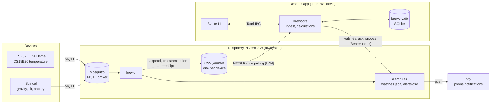

# fermentation-tools

Tools for a small home brewery, focused on hard seltzer. Beer and other fermented drinks work too.

[`brew-app/`](brew-app/) is a desktop app (Tauri + Rust + Svelte) for batches, recipes, ingredient lots, fermentation curves, analytics and alerts. It also contains `brewd`, a daemon that runs on a Raspberry Pi, and the ESPHome firmware for the sensors.

---

## brew-app

The app is meant to be the operating system for the brewery. Sensors report fermentation data, and the app ties that data to batches, recipes, ingredient lots, schedules and production records. Everything is stored in a single local SQLite file.

### How the pieces connect



- **`brewd`** is the logger of record. It runs all the time, subscribes to the broker, and appends each device's readings to a CSV journal. It also evaluates alert watches and sends notifications through [ntfy](https://ntfy.sh).
- **The desktop app** only needs to be open when you use it. When it starts, it fetches whatever was added to the journals since the last sync, using byte-offset `Range` requests, so nothing is lost while it is closed.
- **Fermentrack** was the original plan (v1). That code is kept in `brewcore::fermentrack` and still tested, but the project now uses v2. [ARCHITECTURE.md](brew-app/ARCHITECTURE.md) explains why.

### Features

- **Batches:** lifecycle from planned to packaged, a timeline of events (pitch, additions, measurements, notes), streams bound to vessels, and quick entry for manual readings.
- **Recipes:** immutable versions once used, diffs between versions, and the recipe plan kept separate from batch actuals.
- **Reference data:** ingredients, lots with cost and currency, yeast strains, and vessels.
- **Calculators:** ABV, attenuation, hydrometer and refractometer corrections, sugar additions, YAN and nutrient dosing, pitch rate, and cost per litre.
- **Dashboard and curves:** live status cards, gravity and temperature charts (uPlot), smoothing, and detection of when fermentation is stable or finished.
- **Analytics:** overlays comparing batches, saved queries, per-strain rollups, and CSV export.
- **Alerts:** temperature-band and rate-of-change rules, stale sensors, schedule steps that are due or overdue, and day-N reminders. Alerts are evaluated on the Pi, so they fire even when the desktop is off, and can be acknowledged or snoozed from the app.

Phases 0–6 of [docs/BUILDOUT.md](brew-app/docs/BUILDOUT.md) are built. Phase 7 (production records: cleaning, packaging, inventory, batch reports) has not started. Temperature control (relays driven by the ESPHome `thermostat`) is deferred.

### Layout

```text
brew-app/
├── crates/
│   ├── brewcore/   # all domain logic; no Tauri dependency, tested with plain `cargo test`
│   │   ├── migrations/   # versioned .sql, applied via PRAGMA user_version
│   │   └── src/
│   │       ├── db/           # connection pool, queries per domain
│   │       ├── calc/         # ABV, gravity, YAN, pitch, stability, cost…
│   │       ├── units/        # typed temperature, gravity, quantity, money, time
│   │       ├── journal/      # format-agnostic Range sync: client, record split, offsets
│   │       ├── brewd/        # brewd journal dialect, discovery, alert API client
│   │       ├── fermentrack/  # v1 source (dormant, still tested)
│   │       ├── alert/        # alert rules and evaluation, shared with brewd
│   │       └── sync/         # scheduler and backoff
│   ├── brewd/      # Pi daemon: MQTT → journals, HTTP, alerts, ntfy
│   │   └── deploy/       # brewd.example.toml, brewd.service
│   └── fixtures/   # generated Fermentrack/journal logs, wiremock test server
├── src-tauri/      # thin Tauri shell: commands, app state, logging
├── src/            # Svelte 5 + TypeScript UI
├── firmware/       # ESPHome YAML per device
├── xtask/          # dev helpers (fixtures, demo DB, Pi cross-build)
└── docs/           # build plan, hardware, network, Fermentrack notes
```

### Requirements

- Rust stable (MSRV 1.85, edition 2024)
- Node 24 and npm 11
- Windows. CI runs only on Windows, the only platform the app ships on. `brewcore` and `brewd` are cross-platform.
- To build `brewd` for the Pi: [`cross`](https://github.com/cross-rs/cross), and Docker or Podman.
- To flash firmware: [ESPHome](https://esphome.io).

npm 11 blocks dependency install scripts by default. `package.json#allowScripts` explicitly allows `esbuild`, which Vite needs. Keep that entry when upgrading esbuild.

### Build and run

```sh
cd brew-app
npm ci
npm run build          # do this first: Tauri's build reads ../dist at compile time
npm run tauri dev      # run the desktop app with hot reload
npm run tauri build    # build the installer
```

Checks (the same as CI, in `.github/workflows/ci.yml`):

```sh
npm run check
npm test
cargo fmt --all --check
cargo clippy --workspace --all-targets -- -D warnings
cargo test --workspace
```

### Dev helpers

```sh
cargo xtask demo-db [path]       # seed a database with demo batches, recipes and curves
cargo xtask gen-fixture …        # generate Fermentrack _full.csv or brewd journal logs
                                 #   --format fermentrack|journal --scenario … --rows … --seed …
cargo xtask db-status [path]     # print schema version and table counts
cargo xtask build-pi             # cross-compile brewd for aarch64-unknown-linux-gnu
```

### Configuration and data

| | Default | Override |
|---|---|---|
| Database | `brewery.db` in the Tauri app data dir (`%APPDATA%\dev.xeviert.brew\`) | `BREWAPP_DB` |
| App config | `config.toml` in the same folder | `BREWAPP_CONFIG` |

Sources (brewd journals or Fermentrack), units, poll interval, and the brewd token are all set on the app's Settings and Sources screens.

### Deploying brewd on the Pi

1. Build it: `cargo xtask build-pi`.
2. Copy `target/aarch64-unknown-linux-gnu/release/brewd` to the Pi.
3. Follow the install commands at the top of [`crates/brewd/deploy/brewd.service`](brew-app/crates/brewd/deploy/brewd.service).
4. Copy [`brewd.example.toml`](brew-app/crates/brewd/deploy/brewd.example.toml) to `/etc/brewd/brewd.toml` and fill in:
   - `mqtt.password` for the broker user
   - `http.token`, which is required for writes. Generate one with `openssl rand -hex 16` and paste the same value into the app's Settings.
   - `notify.ntfy_topic`, which is optional. Use a long random string: anyone who knows the topic can read it.
   - the `[[device]]` topic mappings, taken from `mosquitto_sub -v -t '#'`

The HTTP API is meant for the LAN only. Reads require no auth.

### Hardware

| Part | Details |
|---|---|
| Always-on host | Raspberry Pi Zero 2 W, Raspberry Pi OS Lite (64-bit), high-endurance microSD, 5 V 2.5 A supply. Runs Mosquitto and `brewd`. 2.4 GHz Wi-Fi only. |
| Temperature controller | DOIT ESP32 DevKit V1 (30-pin) running ESPHome |
| Temperature probe | DS18B20, waterproof, on GPIO13 with a 4.7 kΩ pull-up from DQ to 3.3 V. More probes share the same one-wire bus and are told apart by address. |
| Gravity | iSpindel (Wemos board, stock firmware). Publishes tilt, gravity, temperature, battery and RSSI over MQTT. Gravity comes out as SG or °P depending on its calibration polynomial; set `gravity.ispindel_unit` in the app to match. |
| Heating / cooling | Not built yet. Planned: relays or SSRs driven by ESPHome's `thermostat`. |

#### Wiring

```text
ESP32 3V3  ──► + rail
ESP32 GND  ──► − rail
ESP32 D13  ──► DQ row
DS18B20 red (VCC)    ──► + rail
DS18B20 black (GND)  ──► − rail
DS18B20 yellow (DQ)  ──► DQ row
4.7 kΩ               DQ row ↔ + rail   (the bus doesn't work without it)
```

### Setup

Set up the Pi first, then the ESP32: ESPHome's MQTT output can't be checked until a broker exists.

1. **Pi base.** Flash Raspberry Pi OS Lite (64-bit) with Raspberry Pi Imager. In *Edit settings*, set the hostname, a user, the 2.4 GHz Wi-Fi **with the Wi-Fi country set** (without it the radio stays off), and enable SSH. SSH in, run `sudo apt update && sudo apt full-upgrade`, and give the Pi a fixed IP (a DHCP reservation or a static address). Everything else points at it.
2. **Mosquitto.** Create two broker users, `devices` for the sensors and `brewd` for the daemon, and turn off anonymous access:
   ```sh
   sudo apt install mosquitto mosquitto-clients
   sudo mosquitto_passwd -c /etc/mosquitto/passwd devices
   sudo mosquitto_passwd /etc/mosquitto/passwd brewd
   sudo chown root:mosquitto /etc/mosquitto/passwd
   sudo chmod 640 /etc/mosquitto/passwd
   printf 'listener 1883\nallow_anonymous false\npassword_file /etc/mosquitto/passwd\n' | sudo tee /etc/mosquitto/conf.d/brew.conf
   sudo sed -i 's/^persistence true/persistence false/' /etc/mosquitto/mosquitto.conf
   sudo systemctl restart mosquitto
   ```
   Persistence is off because `brewd`'s journal is the record, not the broker. To check it works, run `mosquitto_sub -v -t '#' -u brewd -P …` in one session and `mosquitto_pub -t test/hello -m hi -u devices -P …` in another. The same `pub` without `-u` must fail with `not authorised`.
3. **ESP32 firmware.**
   ```sh
   cd brew-app/firmware
   cp secrets.example.yaml secrets.yaml   # gitignored; fill in Wi-Fi, MQTT (devices user) and OTA passwords
   esphome run esp32-1.yaml               # USB the first time, OTA after
   ```
   Set `mqtt.broker` to your Pi's address first. Then copy the probe's address from the boot log (`Found devices`), put it into the `dallas_temp` sensor, and flash again. ESPHome prints the address byte-reversed compared with other tools, and the reversed form is the one it wants. On Windows, run ESPHome from PowerShell or cmd, not Git Bash.
4. **brewd.** Follow [Deploying brewd on the Pi](#deploying-brewd-on-the-pi). On Windows, `cross` 0.2.5 can fail with `couldn't install toolchain`. The fix, once per machine:
   ```sh
   rustup toolchain add stable-x86_64-unknown-linux-gnu --profile minimal --force-non-host
   ```
   Stop `brewd` (`sudo systemctl stop brewd`) before editing `brewd.toml`. A broken config puts it in a 5-second restart loop.
5. **Desktop app.** In Settings, set `brewd.base_url` to `http://<pi>:8080` and paste the HTTP token. Then go to Sources → Load journals.
6. **iSpindel.** Put it in config mode by shorting the `RST` pins a couple of times; it opens an `iSpindel_<chip id>` access point at `http://192.168.4.1`. Give it a name (`ispindel-1`), point it at the broker with the `devices` user, and turn off the Home Assistant integration. Capture one wake cycle with `mosquitto_sub` and copy the real topics into `brewd.toml`.
   - Don't plug the Wemos's USB-C into a computer while the battery is in.
   - Charge it with a plain USB-C charger. Smart chargers aren't supported.

### Docs

- [ARCHITECTURE.md](brew-app/ARCHITECTURE.md): the options that were considered, and why the project went straight to v2
- [docs/BUILDOUT.md](brew-app/docs/BUILDOUT.md): phase-by-phase plan and checklist, stack choices, data model
- [docs/FERMENTRACK-API.md](brew-app/docs/FERMENTRACK-API.md): what Fermentrack actually exposes (v1 reference)

---

## License

MIT. See [LICENSE](LICENSE).
